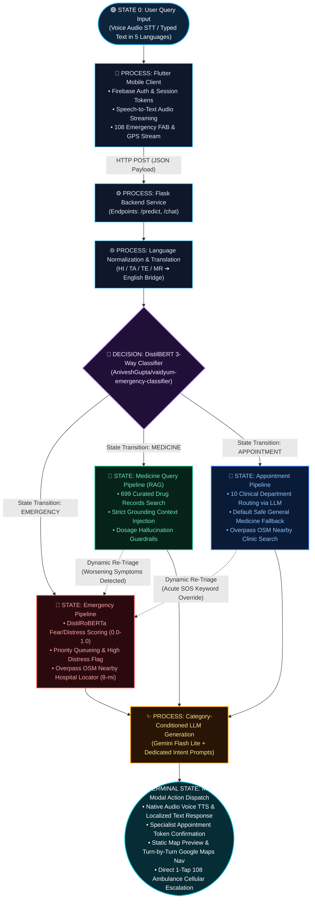

# Vaidyum: Intent-Routed, LLM-Based Emergency Triage System for Rural Healthcare Helplines

[](https://www.python.org/)
[](https://flask.palletsprojects.com/)
[](https://huggingface.co/AniveshGupta/vaidyum-emergency-classifier)
[](https://flutter.dev/)
[](https://firebase.google.com/)
[](https://ai.google.dev/)
[](tests/run_all_phases.py)
[](LICENSE)

---

## 📌 Overview

**Vaidyum** is an automated, intent-routed healthcare helpline triage and question-answering system tailored for rural and semi-urban communities. Rural healthcare helplines frequently receive a mixed stream of life-threatening medical emergencies, symptom/medicine queries, and routine appointment bookings. Most traditional chatbots process incoming calls in a first-in, first-out order using a single conversational flow, inadvertently delaying critical emergency escalations.

Vaidyum operates on the principle that **an automated helpline must detect urgency first**. Incoming messages are triaged into three core categories—**Emergency**, **Medicine Query**, and **Appointment**—and routed through specialized response pipelines:

1. **Emergency**: Prioritizes life-threatening cases with immediate directive guidance, computes a post-classification **distress/fear score** to rank urgency, triggers emergency UI states, enables one-tap 108 ambulance calling, and fetches nearby hospitals within 8 miles (~13 km).
2. **Medicine Query**: Answers are strictly grounded in a structured dataset of 699 verified medicines, their uses, and side effects via **Retrieval-Augmented Generation (RAG)**, suppressing speculative dosage and ungrounded hallucinations.
3. **Appointment**: Requests are intelligently matched across **10 clinical departments**, checking nearby facilities and preparing slot confirmation details with Google Maps navigation.

Non-English queries across regional languages (**Hindi, Tamil, Telugu, Marathi**) are translated prior to classification, ensuring equitable triage without requiring separate language-specific classifiers.

---

## 🏗️ System Architecture



<details>
<summary><b>📐 View Plain Text Representation (ASCII)</b></summary>

```
                                  [ User Input ]
                         (Voice / Text in 5 Languages)
                                       │
                                       ▼
                       ┌───────────────────────────────┐
                       │   Mobile Client (Flutter)     │
                       │ • Firebase Auth & Firestore   │
                       │ • Speech-to-Text / TTS        │
                       │ • Offline First Aid (6 guides)│
                       │ • 108 Ambulance FAB & GPS     │
                       └───────────────┬───────────────┘
                                       │ JSON Request (/predict, /chat)
                                       ▼
                       ┌───────────────────────────────┐
                       │     Flask Backend Pipeline    │
                       └───────────────┬───────────────┘
                                       │
                         [ Language Detection & Translation ]
                                       │
                                       ▼
                       ┌───────────────────────────────┐
                       │   Fine-Tuned DistilBERT       │
                       │   3-Way Intent Classifier     │
                       │ (Emergency / Med / Appt)      │
                       └───────┬───────┼───────┬───────┘
                               │       │       │
            ┌──────────────────┘       │       └──────────────────┐
            ▼                          ▼                          ▼
 ┌──────────────────────┐  ┌──────────────────────┐  ┌──────────────────────┐
 │    EMERGENCY PATH    │  │ MEDICINE QUERY PATH  │  │   APPOINTMENT PATH   │
 ├──────────────────────┤  ├──────────────────────┤  ├──────────────────────┤
 │ • DistilRoBERTa Fear │  │ • Symptom keyword    │  │ • 10 Clinical Dept   │
 │   Distress Scoring   │  │   matching over 699  │  │   Routing via LLM    │
 │ • High Distress Flag │  │   medicine records   │  │ • Default fallback   │
 │ • Overpass OSM 8-mi  │  │ • Grounding Context  │  │ • Overpass OSM 8-mi  │
 │   Hospital Locator   │  │   Injection (RAG)    │  │   Hospital Locator   │
 └──────────┬───────────┘  └──────────┬───────────┘  └──────────┬───────────┘
            │                          │                         │
            └──────────────────┬───────┴─────────────────────────┘
                               ▼
            ┌───────────────────────────────────────────┐
            │ Category-Conditioned LLM Generation       │
            │ (Gemini Flash Lite + Dedicated Prompts)   │
            │ + Safety Nets & Mid-Thread Re-Triage      │
            └──────────────────┬────────────────────────┘
                               ▼
            ┌───────────────────────────────────────────┐
            │ Response Delivery, Slot Confirmation,     │
            │ Static Map & Turn-by-Turn Google Maps Nav │
            └───────────────────────────────────────────┘
```

</details>

---

## ✨ Key Features

### 1. 3-Way Intent Triage
- **Fine-Tuned DistilBERT**: Fast sequence classification deployed from Hugging Face Hub (`AniveshGupta/vaidyum-emergency-classifier`).
- Achieves **95% accuracy** and **93% Emergency recall** on held-out test splits, outperforming standard TF-IDF + Logistic Regression baselines (88% accuracy / 87% recall).
- Normalizes training data into first-person symptom templates to eliminate formatting shortcuts.

### 2. Post-Classification Distress Scoring
- Emergency messages pass through a pretrained `j-hartmann/emotion-english-distilroberta-base` model.
- Extracts the **fear score** (0.0 to 1.0) as an internal distress metric to order urgency among emergency callers.
- Operates purely as a post-classification ranking signal—never alters classification decisions.

### 3. Grounded Medicine Answering (RAG)
- Queries are matched against a curated 699-record dataset (`darkknight25/medical_medicine_dataset`) containing verified drugs, indications, and side effects.
- The retrieved entries are passed to the language model as explicit reference context, preventing speculative dosage and reducing clinical hallucinations.

### 4. Clinical Department Routing
- Automatically maps routine consultations across **10 clinical specialties**:
  `General Medicine`, `Cardiology`, `Orthopedics`, `Pediatrics`, `Dermatology`, `Neurology`, `ENT`, `Gynecology`, `Ophthalmology`, and `Gastroenterology`.
- Gracefully defaults to *General Medicine* if ambiguous or upon network disruption, preventing blocked scheduling flows.

### 5. Multi-Layered Safety Nets & Mid-Conversation Re-Triage
- **Emergency Keyword Override**: Instantly escalates appointment inquiries containing acute red-flag terms (e.g., *"crushing chest pain"*, *"cannot breathe"*, *"unresponsive"*).
- **Dynamic Mid-Conversation Re-Triage**: Evaluates conversation history when both worsening indicators (*"getting worse"*) and high-risk symptoms (*"chest"*, *"breathing"*, *"bleeding"*) appear.
- **Explicit SOS Intent**: A dedicated "I need more help" follow-up chip immediately escalates threads to Emergency regardless of initial classification.

### 6. Geolocation & Hospital Hand-off
- Locates medical facilities within an **8-mile radius (~13 km)** using OpenStreetMap's Overpass API with multi-mirror automatic failover (`overpass.openstreetmap.fr`, `overpass-api.de`, `lz4.overpass-api.de`, `z.overpass-api.de`, `overpass.kumi.systems`).
- Reverse geocoding via Nominatim for accurate address resolution.
- Computes Haversine distances, generates static map previews, and hands navigation directly to Google Maps via Android Intents.

### 7. Multilingual Voice-Enabled Mobile Client (Flutter)
- Native support for 5 regional languages: **Hindi (hi), English (en), Tamil (ta), Telugu (te), and Marathi (mr)**.
- Hands-free voice dictation (STT) and automated speech playback (TTS).
- Secure phone number authentication via **Firebase Auth** and private per-user conversation histories in **Cloud Firestore**.
- **Offline First-Aid Manual**: Pre-bundled, localized step-by-step guides for 6 critical situations: snake bite, heavy bleeding, burns, choking, heat stroke, and bone fractures.
- Persistent floating **Call 108** ambulance button.

---

## 📊 Benchmark & Evaluation Results

### Intent Classifier Performance (Held-Out Test Split)

| Model | Accuracy | Emergency Recall | Notes |
|:---|:---:|:---:|:---|
| **TF-IDF + Logistic Regression** | 88.0% | 87.0% | Traditional baseline |
| **DistilBERT (Initial)** | 97.0% | 100.0% | Inflated by list-formatting artifact |
| **DistilBERT (Corrected)** | **95.0%** | **93.0%** | **Reported final model (natural phrasing)** |

> [!NOTE]
> Emergency recall is prioritized over raw accuracy because a false negative (failing to recognize a critical emergency) carries the highest clinical cost.

### Comprehensive Test Coverage

| Test Phase | Scope | Tests Passed | Status |
|:---|:---|:---:|:---:|
| **Phase 1** | Pure Unit Functions (Haversine, keyword checks, payload builders) | 33 / 33 | ✅ PASS |
| **Phase 2** | Component Integration (Model drivers, Overpass mirrors, geocoding fallbacks) | 24 / 24 | ✅ PASS |
| **Phase 3** | System Route Integration (Flask test client, re-triage, overrides) | 34 / 34 | ✅ PASS |
| **Phase 4** | Flutter Client Tests (Message model, state serialization, SOS propagation) | 20 / 20 | ✅ PASS |
| **Total** | **End-to-End Bottom-Up Test Suite** | **111 / 111** | **✅ 100% PASS** |

---

## 🔌 API Endpoints

The Flask backend exposes 5 core REST endpoints:

### 1. `GET /health`
Returns service status and verification that all models and datasets are in memory.
```json
{
  "status": "ok",
  "classifier": "AniveshGupta/vaidyum-emergency-classifier",
  "emotion_model": "j-hartmann/emotion-english-distilroberta-base",
  "llm": "gemini-flash-lite-latest",
  "medicines_loaded": 699
}
```

### 2. `POST /predict`
Single-turn triage classification, distress scoring, and initial response generation.
- **Request Body:**
  ```json
  {
    "query": "I am experiencing sudden crushing chest pain and breathlessness",
    "language": "en"
  }
  ```
- **Response:**
  ```json
  {
    "category": "Emergency",
    "confidence": 0.984,
    "distress_score": 0.892,
    "escalation_flag": true,
    "hospital_lookup_required": true,
    "response": "Please remain calm. Call emergency services (108) immediately...",
    "detected_language": "English"
  }
  ```

### 3. `POST /chat`
Multi-turn conversational triage with mid-thread worsening detection and SOS overrides.
- **Request Body:**
  ```json
  {
    "message": "It is getting much worse, I feel faint",
    "history": [
      {"sender": "user", "text": "I had chest tightness earlier"},
      {"sender": "bot", "text": "Please monitor your breathing..."}
    ],
    "language": "en",
    "follow_up_intent": "worsening"
  }
  ```

### 4. `POST /hospitals`
Finds nearby medical facilities within 8 miles (~13 km) using OSM Overpass.
- **Request Body:**
  ```json
  {
    "latitude": 12.9692,
    "longitude": 79.1559,
    "radius_miles": 8
  }
  ```

### 5. `POST /book_hospital`
Confirms a triage/appointment slot, generates map links, and formats navigation coordinates.
- **Request Body:**
  ```json
  {
    "hospital_name": "District General Hospital",
    "latitude": 12.9710,
    "longitude": 79.1600,
    "category": "Emergency",
    "requested_time": "Immediate"
  }
  ```

---

## 📁 Repository Structure

```
helpline-triage-nlp/
├── app.py                             # Main Flask backend service & API endpoints
├── requirements.txt                   # Python dependencies (PyTorch, Transformers, Flask, etc.)
├── Dockerfile                         # Container build definition for Cloud Run / Docker
├── run_pipeline.py                    # CLI runner for quick end-to-end pipeline execution
│
├── data/
│   ├── raw/                           # Raw datasets
│   └── processed/
│       └── medicine_dataset.csv       # 699 verified medicine records for grounding
│
├── models/
│   ├── baseline_classifier.joblib     # Scikit-learn TF-IDF + Logistic Regression baseline
│   └── transformer_classifier/        # Hugging Face DistilBERT fine-tuned model artifacts
│
├── tests/
│   ├── _stub_app_imports.py           # Isolation test stubs for fast unit execution
│   ├── run_all_phases.py              # Ordered Bottom-Up test runner (Phases 1-3)
│   ├── test_phase1_unit.py            # Phase 1: Pure helper functions (33 tests)
│   ├── test_phase2_component_integration.py # Phase 2: Model & network stubs (24 tests)
│   └── test_phase3_system_routes.py   # Phase 3: Flask HTTP route client checks (34 tests)
│
├── helpline_app/                      # Flutter mobile client application
│   ├── lib/
│   │   ├── main.dart                  # Flutter entry point
│   │   ├── theme.dart                 # Design system, palettes, typography
│   │   ├── auth/                      # Phone number OTP login & splash screens
│   │   ├── chat/                      # Triage chat screen, conversation history, profile
│   │   ├── firstaid/                  # Offline multilingual first-aid guides
│   │   ├── hospitals/                 # Nearby hospital locator & Google Maps integration
│   │   └── widgets/                   # SOS chips, 108 FAB, language selector
│   └── test/                          # Flutter unit & widget tests (20 tests)
│
├── prepare_triage_dataset.py          # Data cleaning & synthetic triage dataset builder
├── generate_appointment_dataset.py    # Generates natural appointment queries
├── load_medicine_dataset.py           # Medicine dataset ingestion script
├── train_baseline_classifier.py       # Trains TF-IDF + Logistic Regression baseline
├── train_transformer_classifier.py    # Fine-tunes DistilBERT sequence classifier
├── score_emergency_distress.py        # Emotion model inference & distress scoring
├── design_and_test_prompts.py         # Category-specific prompt engineering
└── evaluate_routed_vs_baseline.py     # Qualitative transcript evaluation script
```

---

## 🚀 Getting Started

### Prerequisites
- **Python**: 3.10 or higher
- **Flutter SDK**: 3.x+ (for the mobile client)
- **Google Gemini API Key**: Obtainable from [Google AI Studio](https://aistudio.google.com/)
- **Firebase Project**: (Optional for local backend testing, required for mobile auth and chat history)

---

### Backend Setup

1. **Clone the repository:**
   ```bash
   git clone https://github.com/AniveshGuptaOfficial/helpline-triage-nlp.git
   cd helpline-triage-nlp
   ```

2. **Create and activate a virtual environment:**
   ```bash
   # Windows (PowerShell)
   python -m venv venv
   .\venv\Scripts\Activate.ps1

   # Linux / macOS
   python3 -m venv venv
   source venv/bin/activate
   ```

3. **Install dependencies:**
   ```bash
   pip install -r requirements.txt
   ```

4. **Configure environment variables:**
   Create a `.env` file in the project root:
   ```env
   GEMINI_API_KEY=your_gemini_api_key_here
   PORT=8080
   FLASK_ENV=production
   ```

5. **Run the backend server:**
   ```bash
   python app.py
   ```
   The service will load the transformer and emotion models into memory and listen on `http://127.0.0.1:8080`.

---

### Running the Test Suite

Execute the ordered bottom-up test harness to verify helper functions, model drivers, and API routes:

```bash
# Run all Python backend test phases (91 tests)
python tests/run_all_phases.py
```

To run the Flutter mobile client test suite:
```bash
cd helpline_app
flutter test
```

---

### Running the Mobile Client

1. Navigate to the app directory:
   ```bash
   cd helpline_app
   ```
2. Install Flutter packages:
   ```bash
   flutter pub get
   ```
3. Update the backend endpoint in `lib/chat/chat_page.dart` (point to your local machine IP or deployed Cloud Run URL).
4. Run on an Android emulator or connected device:
   ```bash
   flutter run
   ```

---

## ⚠️ Medical & Safety Disclaimer

> [!CAUTION]
> **Vaidyum is designed as an investigative AI triage and decision-support system for academic and experimental research.**
>
> - It does **not** provide clinical medical diagnoses or definitive drug prescriptions.
> - In any life-threatening situation or severe medical emergency, users must immediately contact official emergency services (such as **108** in India or **911** in the US) or proceed to the nearest emergency room.
> - Medicine guidance is retrieved as informative reference material only and must be validated by a licensed healthcare professional.

---

## 📜 Citation

If you use or reference this work in your research, please cite:

```bibtex
@article{gupta2026vaidyum,
  title     = {Vaidyum: An Intent-Routed, LLM-Based Question Answering System for Emergency Triage in Rural Healthcare Helplines},
  author    = {Gupta, Anivesh},
  journal   = {School of Computer Science and Engineering, Vellore Institute of Technology},
  year      = {2026},
  address   = {Vellore, India},
  email     = {anivesh.gupta2023@vitstudent.ac.in}
}
```

### Standard Citation
> **Anivesh Gupta**, *"Vaidyum: An Intent-Routed, LLM-Based Question Answering System for Emergency Triage in Rural Healthcare Helplines"*, School of Computer Science and Engineering, Vellore Institute of Technology, Vellore, India, 2026. Contact: `anivesh.gupta2023@vitstudent.ac.in`.

---

## 👤 Author

* **Anivesh Gupta**  
  School of Computer Science and Engineering, Vellore Institute of Technology, Vellore, India  
  GitHub: [@AniveshGuptaOfficial](https://github.com/AniveshGuptaOfficial)  
  Email: [anivesh.gupta2023@vitstudent.ac.in](mailto:anivesh.gupta2023@vitstudent.ac.in)
